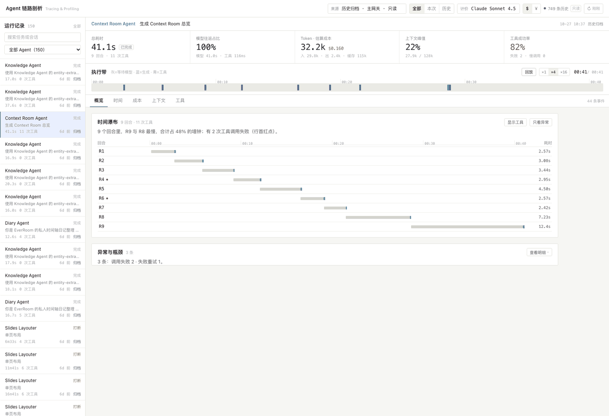
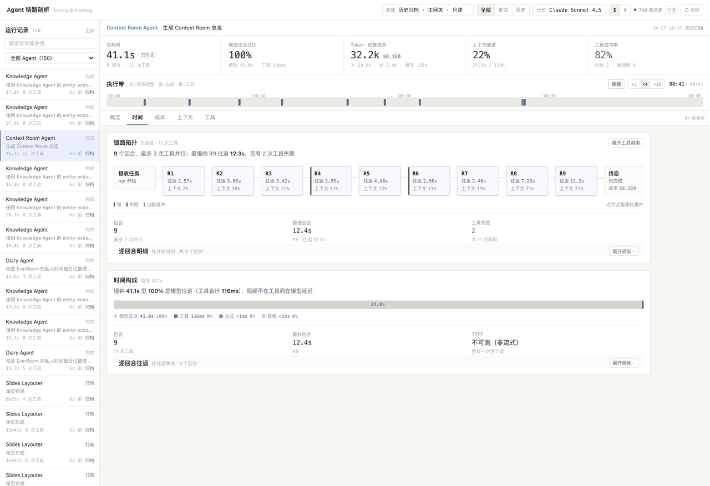
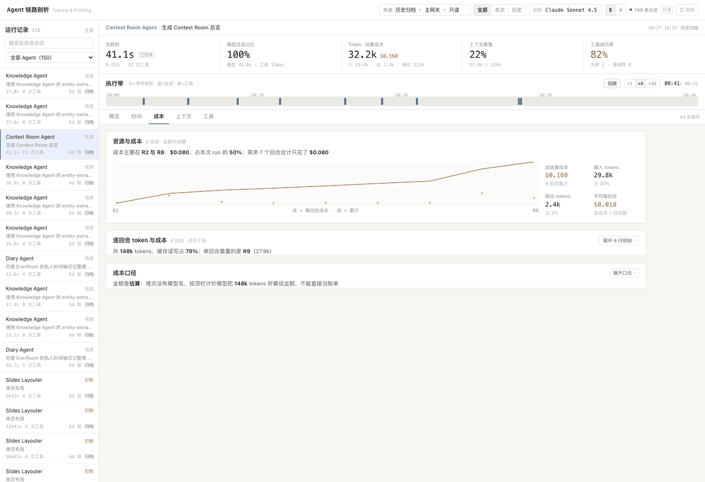
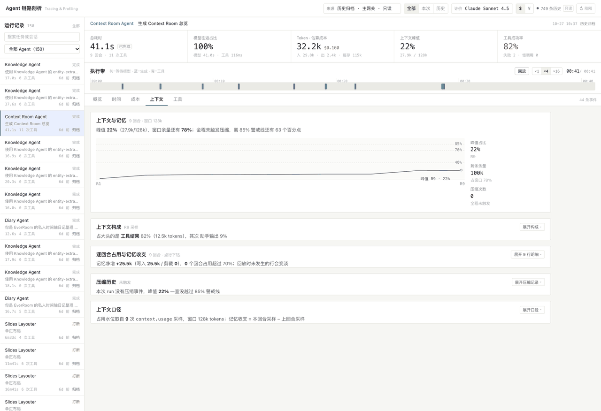
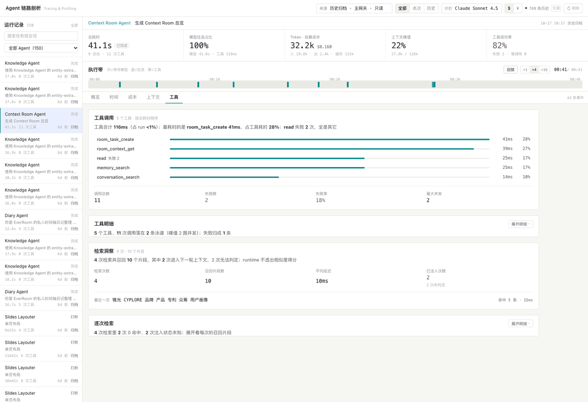

# Agent 链路剖析看板（Tracing & Profiling Dashboard）

> 状态：已交付（2026-11-02）
> 范围：独立浏览器看板（不进入产品导航、不随 Desktop 打包），复用调试台的 `/@agent-debug/*` 同源代理与本机归档读取
> 相关：`docs/agent-debug-page.zh-CN.md`（调试台）、`docs/agent-debug-persistence.zh-CN.md`（归档）、`docs/agent-debug-offline-archive.zh-CN.md`（离线归档来源）

## 1. 目标与定位

调试台回答「这个 run 跑了什么」；**看板回答「为什么慢、为什么贵、为什么失忆、为什么报错」**。
它把同一条事件流按四个维度做聚合与可视化，并保证每个数字都能回溯到原始事件：

| 维度 | 看板给出的结论 | 数据来源 |
| --- | --- | --- |
| 时间 / 拓扑 | 墙钟被谁吃掉：工具、生成、还是模型往返 | `context.usage` 回合边界 + delta 时间戳 + tool 生命周期 |
| 资源 / 成本 | 每回合 token 增量与估算成本、成本最陡的一段 | `context.usage.payload.runUsage`（累计值差分） |
| 上下文 / 记忆 | 占用百分比、分段构成、写入与剪裁、压缩历史 | `context.usage.payload.{tokens,contextWindow,segments}`、`context.compaction` |
| 工具 / 检索 | 调用全景、错误归类、并发交错、RAG 召回内容 | `tool.*` 事件 + `memory_search`/`conversation_search` 等返回值 |



## 2. 打开方式

```bash
pnpm debug:agents                   # 启动独立 dev server（默认 127.0.0.1:5199）
open http://127.0.0.1:5199/debug/agent-dashboard.html
open http://127.0.0.1:5199/debug/agent-debug.html        # 原调试台，仍在
```

来源发现与调试台完全一致：先找运行中的 Gateway（进程存活时走 `/@agent-debug/gateway/:id/*` 代理，Bearer token 只存在于 dev server 的 Node 进程），
再退回本机归档 `~/Library/Application Support/EverOffice/agent-debug/<source>/`（EverOffice 不启动也能复盘历史 run）。

## 3. 信息分层与视觉（2026-11-02 改版）

第一版把四个维度的所有图表堆在一屏，深色 + 高密度，结果是「不知道哪是哪」。改版后按**渐进披露**重排：

- **浅色纸面**：底色 `#f6f6f3`、卡片纯白、1px 细线分隔；无阴影、无渐变、圆角 ≤ 3px。
- **一屏五层，每层只回答一个问题**：
  1. 顶栏（是谁的数据）→ 2. run 摘要一行（哪条 run）→ 3. 五个数字（多久 / 慢在哪 / 多贵 / 多满 / 稳不稳）
  → 4. 执行带（时间怎么花的）→ 5. 分页（概览 / 时间 / 成本 / 上下文 / 工具）。
- **每块内容 = 标题 + 一句结论 + 主图 + 折叠明细**：首屏只放结论句和一张主图，明细表、全量列表、口径说明全部收进「展开明细」。
- **色彩只有四种语义**：蓝=模型/主指标、青=工具、琥珀=成本/慢、红=失败，其余一律灰阶；异常用行首小圆点而不是整块染色。
- **字号阶梯**：数字 23/15、标题 14、结论 13、正文 12.5、标签 11；等宽只用于数字与标识。

## 4. 交互模型

- **执行带（签名元素）**：把整条 run 压成一条带子——时间构成（工具/生成/模型往返）、上下文占用曲线、异常刻度。拖动、点键盘 ← →、或按播放键即可**回放**；所有面板按同一光标弱化「尚未发生」的步骤。
- **下钻探针**：点甘特行 / 拓扑节点 / 异常条目 → 右侧抽屉展示该步骤的原始 Prompt 输出、reasoning、工具入参出参、进度推送、以及关联的**原始事件 JSON**。
- **异常染色**：失败工具红、慢步骤（>10s）与取消黄、上下文 >80% 提示溢出、同名同参 ≥3 次判循环、失败后再调用判「重试风暴」。
- **口径开关**：顶栏可切计价模型（埋点不含模型名，成本为**估算**）与币种（$ / ¥）。
- **深链**：`?run=<runId>&tab=cost&step=tool:<toolCallId>&cursor=200000`，把「某条 run 的某个步骤 / 某个时刻」原样发给同事。
  快照只带最近 150/300 条 run，超窗口的 run 会明确提示「不在当前快照窗口内」，不会静默换成别的 run。
- **键盘**：执行带上 `←` / `→` 步进、`Home` / `End` 跳到首尾、`Esc` 退出回放（`Esc` 同时关闭下钻抽屉）。

### 四个维度页

| 维度 | 截图 | 一眼能回答的问题 |
| --- | --- | --- |
| 时间 · 拓扑 |  | 回合串行还是并行、哪个回合最慢、时间是花在模型往返还是出字上 |
| 资源 · 成本 |  | 钱主要花在哪两个回合、累计曲线在哪一段抬升、token 是输入还是输出主导 |
| 上下文 · 记忆 |  | 占用峰值离溢出还有多远、构成里谁最占地方、写入/剪裁了多少、有没有触发压缩 |
| 工具 · 检索 |  | 哪个工具最费时间、失败归成几类、几路并发、检索召回了什么 |

## 5. 派生口径（重要，避免误读）

看板不做「看起来合理」的猜测，拿不到的数据一律显示 `—` 并标注原因：

1. **回合边界 = `context.usage` 事件**。runtime 只在模型回合结束时透出累计用量，因此 token 归属以回合为单位。
2. **TTFT 需要流式**。pi runtime 多数情况下一次性下发整段文本（每回合只有 1 条 `message.delta`），此时 TTFT **不可测**（显示「不可测（非流式）」），模型延迟按「模型往返 = 回合时长 − 回合内工具 − 生成跨度」归因。
3. **生成跨度 = delta 聚类**。相邻 delta 间隔 >1.2s 即断开，工具执行期间的停顿不会被算进生成。
4. **工具耗时按时间并集**。并行调用只算一次（`assignLanes` 贪心分配泳道 + `maxConcurrency` 求峰值），与「调用耗时之和」区分。
5. **成本 = token 增量 × 公开单价**，`cacheRead/cacheWrite` 单列计价；模型未知，顶栏可切换，UI 始终标注「估算」。
6. **RAG 相似度不做假**。当前 runtime 的检索工具不透出 similarity，看板显示「相似度未透出」，只呈现查询、命中数、召回片段、是否进入后续上下文（按下一回合输入 token 增量判定）。
   0 命中时 runtime 返回的是「没有匹配」提示句，不当成召回片段，也不判「已注入上下文」。
7. **CPU / 内存等进程指标不在埋点里**，看板不伪造；本维度以 token、并发度、事件速率这些**真实可得的资源信号**代替。

## 6. 代码结构

```
apps/desktop/debug/agent-dashboard.html          入口（与调试台同一个 dev server）
apps/desktop/src/renderer/src/agent-dashboard/
  main.tsx / Dashboard.tsx                       外壳：状态、标签页、抽屉
  state/useDashboardData.ts                      来源发现 → 快照轮询 → 事件增量拉取
  insight/types.ts                               派生模型（回合/工具/上下文采样/异常/检索）
  insight/buildTrace.ts                          事件流 → 派生模型（唯一的计算中心）
  insight/analyze.ts                             时间构成、工具统计、异常清单、阈值常量
  insight/timeMath.ts                            区间并集、delta 聚类、并发泳道
  insight/toolErrors.ts                          工具错误自动归类（纯文本启发式）
  insight/retrieval.ts                           RAG/记忆检索的查询与召回解析
  insight/pricing.ts                             计价表与成本格式化
  insight/format.ts                              看板格式化（ms/token/%/成本）
  components/Panel.tsx                           分层容器：标题 + 一句结论 + 可折叠明细（所有面板复用）
  components/*                                   逐维度面板 + 执行带 + 时间瀑布 + 下钻抽屉 + JSON 查看器
  styles/tokens.css, base.css, dashboard.css     设计令牌与骨架
apps/desktop/tests/agent-dashboard-insight.test.ts 派生层单测（真实归档 fixture 驱动）
apps/desktop/tests/fixtures/agent-dashboard/*.ndjson 脱敏的真实 run 快照
```

## 7. 验收

```bash
cd apps/desktop && ./node_modules/.bin/vitest run tests/agent-dashboard-insight.test.ts tests/agent-dashboard-default-run.test.ts
cd apps/desktop && ./node_modules/.bin/tsc --noEmit
cd apps/desktop && ./node_modules/.bin/vite build --config vite.agent-debug.config.mts   # 两个入口都应产出
```

单测断言的是**口径与不变量**（回合数对齐 `context.usage` 条数、工具数对齐 `tool.started`、拆解分段不越墙钟、并行并集 ≤ 时长之和、
成本 = 各回合之和、失败必带归类、非流式回合不伪造 TTFT），而不是易变的绝对数值。

## 8. 已知边界

- 环形缓冲淘汰的 run 事件不完整：面板照实展示现存事件，异常清单不会假装「一切正常」。
- 单 run 事件上限 1000 条 × 6 页：超长 run 只保留最新一段（顶栏会显示事件条数供核对）。
- 归档来源是只读的：不写入、不修改、不删除归档文件。
