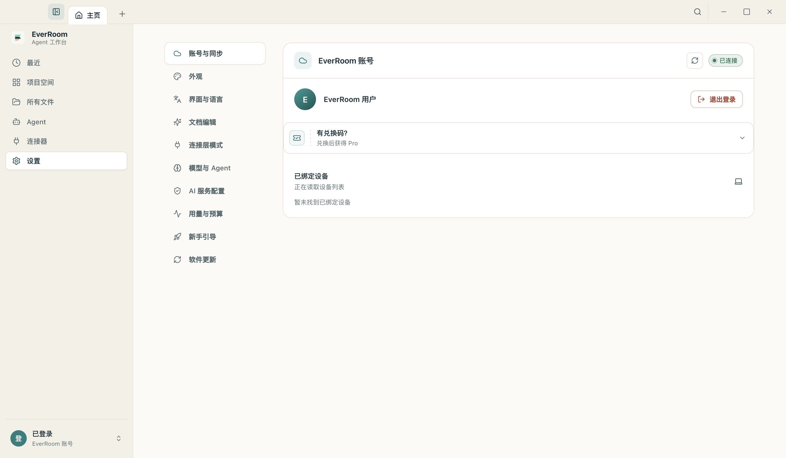
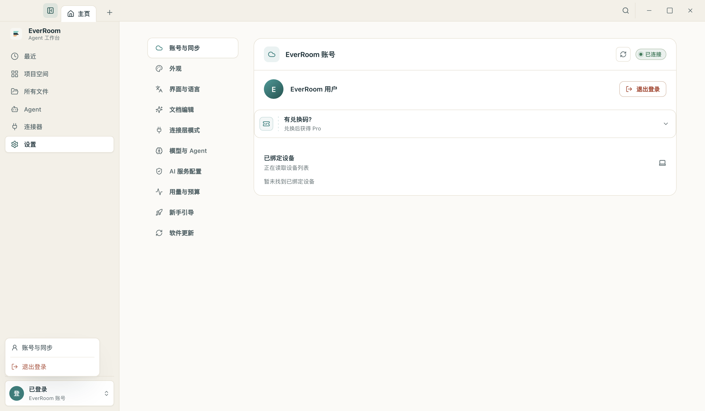
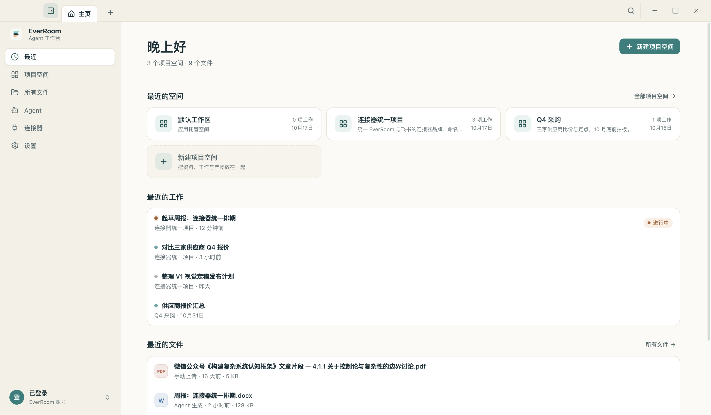

# 主页六页 UI 与文案评审（设置独立入口 + 文案精简）

> 状态：**已实现**（2026-11-02）。范围：主页标签的六个页面
> —— 最近 / 项目空间 / 所有文件 / Agent / 连接器 / 设置。
> 目标：① 设置从「点账号」里挪出来，成为与其它页面并列的一级页面；
> ② 逐条评审页面上的文本，判断标准只有一条 —— **删掉这句，用户还能不能完成这件事**。

## 1. 设置页：从账户行里搬出来

| 项 | 之前 | 现在 |
| --- | --- | --- |
| 入口位置 | 侧栏底部账户行右侧的齿轮（整行点击都进设置） | 侧栏一级入口，排在「连接器」下面；账户行不再跳页 |
| 账户行行为 | 打开设置页 | 打开账号菜单：**账号与同步** / **退出登录**（未登录时只有「登录账号」） |
| 页面标题 | 设置页自带 `PageHeader`「设置」+ 左侧 10 项分区导航，和外壳导航重复 | 去掉自带页头（`hideHeader`），保留左侧分区导航，内容列宽与其它页对齐（1080） |
| 深链 | 无 | `openSettings('settings-account')`：账号菜单可直达「账号与同步」 |
| 分区顺序 | 账号 → 连接层 → 模型 → 运行时 → 用量 → 引导 → 编辑 → 外观 → 语言 → 更新 | 账号 → 外观 → 界面与语言 → 文档编辑 → 连接层模式 → 模型与 Agent → AI 服务配置 → 用量与预算 → 新手引导 → 软件更新（先「你是谁」，再「界面长什么样」，然后能力，最后维护） |

实现落点：

- `workbench/state/store.ts`：新增 `settingsSection` + `openSettings(section?)`。
- `workbench/shell/HomeSidebar.tsx`：导航数组加「设置」；账户行改成 Radix 菜单触发器（`aria-haspopup="menu"`）。
- `workbench/home/SettingsPage.tsx`：宿主透传 `hideHeader` / `section`。
- `components/pages/SettingsPage.tsx`：新增可选 `hideHeader`、`section`（默认值保持旧行为，原型外壳 `OfficeProto` 仍可用）。

## 2. 文案评审结论

判定口径：
- **删** = 删掉不影响使用（重复、装饰、实现细节）；
- **改** = 原句在讲实现或讲不清，换成用户能直接用的说法；
- **留** = 删掉就没人知道该干什么（空态动作、错误原因、数据口径）。

### 2.1 最近

| 位置 | 原文 | 结论 |
| --- | --- | --- |
| 页头小标 | 「主页」 | 删：标签就叫「主页」，侧栏叫「最近」，两处都在说同一件事 |
| 副标题 | 「文件库 9 个文件 · 3 个项目空间」（加载中会变「正在读取文件库…」，失败变「文件库暂不可用」） | 改：「3 个项目空间 · 9 个文件」；拿不到数字就不提数字，状态交给下面的「最近的文件」说 |
| 无数据时副标题 | 无 | 增：「一个项目空间装一个项目的资料、工作与产物。」（此时没有数字可讲，给一句能照做的话） |
| 右上按钮 | 「所有文件」+「新建项目空间」 | 删「所有文件」：侧栏有同名入口，下面「最近的文件」分区也有「所有文件 →」 |
| 最近的空间 | 「全部空间 →」 | 改：「全部项目空间 →」（页面与实体统一叫「项目空间」） |
| 最近的工作 | 「全部空间 →」（指向「项目空间」页） | 删：没有「全部工作」页，这个按钮点了只是跳到另一个页 |
| 空态·空间 | 「还没有项目空间 · 新建一个来组织资料与工作。」 | 改：「还没有项目空间。新建一个，把资料、工作和产物放在一起。」 |
| 空态·工作 | 「还没有工作 · 打开一个项目空间开始第一次任务。」 | 改：「还没有工作。打开一个项目空间就能开始第一项工作。」 |
| 新建卡 | 「装一个项目的资料、工作与产物」 | 改：「把资料、工作与产物放在一起」（原文读起来像「装一个项目」，且三个页面各写一遍不同说法） |
| 空态·文件 | 「在「所有文件」页导入后，最近文件会出现在这里。」 | 改：「导入文档后，最近打开的文件会出现在这里。」（说明白「最近打开」才是排序口径） |

### 2.2 项目空间

| 位置 | 原文 | 结论 |
| --- | --- | --- |
| 页头小标 | 「工作区」 | 删：既不准确（产品里叫项目空间），也只是重复 |
| 副标题 | 「3 个项目空间 · 4 项工作；点开进入独立标签页。」 | 改：「3 个项目空间 · 4 项工作」（后半句是实现细节，用户不需要知道） |
| 工具条右侧 | 「3 个空间」 | 删：和副标题同一个数字；只在搜索时显示「匹配 1 / 3」 |
| 搜索占位 | 「搜索空间名称、描述或目标」 | 改：「搜索名称、描述或目标」（占位符里不必再复述「空间」） |
| 空态 | 「一个项目空间装一个项目的资料、工作与产物；创建后进入三步引导。」 | 改：去掉「创建后进入三步引导」（引导会自己出现，提前承诺反而增加阅读负担） |
| 搜索无结果 | 「没有匹配的空间 · 试试别的关键词。」 | 改：「没有匹配的项目空间。」（「试试别的关键词」是空话，用户已经搜过了） |
| 删除确认 | 「空间下的工作会移回默认空间；删除后资料与产物不会再按这个空间归类。」 | 改：「空间里的工作会移回默认空间。删除后，资料与产物不再按这个空间归类。」 |

保留：空间卡上的「0 项工作 · 10月17日」「默认」、行内重命名/删除的 aria-label（`重命名 X` / `删除 X`），
以及「已重命名项目空间 / 重命名失败」这类操作结果提示 —— 删掉任何一条，用户就不知道发生了什么。

### 2.3 所有文件

| 位置 | 原文 | 结论 |
| --- | --- | --- |
| 页头小标 | 「文件库」 | 删：与页面主题重复，且只有三页有小标，本来就不统一 |
| 副标题 | 「文件库共 9 个文件；可打开文档按最近更新排序。」+ 工具条「5 个可打开文档」+ 页脚「当前加载最近 5 个可打开文档（文件库共 9 个条目）。」 | 三处说同一件事，合并成一句：「文件库共 9 个文件，其中 5 个可在此打开（按最近更新排序）。」页脚只在真的被 200 条上限截断时才出现 |
| 「可打开」 | — | 留：文件库里有图片等打不开的条目，不解释差值，用户会以为文件少了 |
| 空态·不可用 | 「当前无法连接桌面文件服务（浏览器预览或网关未就绪时属预期）。」 | 改：「桌面文件服务没有响应。重试一次；仍然失败请重启 EverRoom。」（原文在向用户解释我们的架构） |
| 空态·无文件 | 「导入本地文档或从连接器同步资料，之后就能在这里打开。」 | 改：加顿号与「就」，「导入本地文档，或从连接器同步资料，之后就能在这里打开。」 |
| 搜索无结果 | 「没有匹配的文件 · 换个关键词或来源试试。」 | 改：「没有匹配的文件。」 |
| 导入按钮 title | 「桌面文件服务未就绪，暂时无法导入」 | 留：只在按钮禁用时作为悬停解释 |

### 2.4 Agent

| 位置 | 原文 | 结论 |
| --- | --- | --- |
| 页名 | 「智能体」（侧栏却叫「Agent」） | 改：统一叫「Agent」（应用其它文案本来就用 Agent：Agent 工作台、本机 Agent、Agent 生成） |
| 副标题 | 「全局唯一的智能体，所有项目空间共用」 | 改：「全局唯一，所有项目空间共用同一个 Agent。」 |
| 简介兜底 | 「网关未返回简介」 | 改：「还没有简介」（讲接口不讲产品） |
| 读取失败 | 「人格设定暂不可用 · 检查桌面服务是否已启动。」 | 改：「Agent 设定读取失败。」+ 就地「重试」按钮 |
| 卡片标题 | 「人格设定」（和上面「人格」标签重复） | 删 |
| 页标题 | 「Agent」 | 改（2026-11-03，页面改为直接复用原型代码）：标题与 hint 照原型「智能体 / 管理本地 Agent 的知识、工具与人格」 |
| Hero 状态 | — | 状态 pill 照原型 `op-pill`：「运行中 / 连接中 / 未连接」（取真实读取结果）；右侧「调试」按钮照原型 `op-ghost-btn`，开 Agent 调试窗口 |
| 提示词空态 | 「该 Agent 没有可展示的系统提示词。」 | 改：「这个 Agent 没有可展示的系统提示词。」 |
| 画像说明 | 「智能体按这份画像理解你，随协作持续沉淀。」/「这份画像还没被整理过（沿用的是你交代过的原始记忆，按标签分组）。」 | 改（2026-11-03，画像改为「大卡片 + 卡内标签」并注入系统上下文）：**说明文案整体删除**——画像本身由卡片与标签自解释，不再在卡片上方挂一段解释（fallback 态也不再说明） |
| 画像空态 | 「在对话里说「记住：我是…」，或让 Agent 调用 memory_remember 后会出现在这里。」 | 改：「还没有用户画像。在对话里告诉 Agent 关于你的事，它记下来后会出现在这里。」（`memory_remember` 是工具名，不该给用户看） |
| 经验空态 | 「还没有沉淀经验」 | 改：「还没有积累经验。做过的工作越多，这里沉淀越完整。」 |

### 2.5 连接器

| 位置 | 原文 | 结论 |
| --- | --- | --- |
| 副标题 | 「连接后，Agent 可在工作途中即席查询这些来源 · 已连接 2/7」 | 改：「Agent 在工作中可以直接查询这些来源 · 已连接 2 / 7」（「即席」「工作途中」是内部说法） |
| 卡片兜底描述 | 「Agent 工作途中可即席查询该来源」 | 改：「Agent 在工作中可直接查询该来源」（一行内显示不下会截断） |
| 原型/离线态 | 「原型预览 · 未连接桌面服务，数据仅为静态示意」 | 改：「未连接桌面服务，当前是静态示意」 |
| 空分类 | 「该分类下没有连接器」 | 改：「这个分类下还没有连接器。」 |
| 模块关闭 | 「连接器模块未启用（网关配置）」 | 改：「连接器模块未启用，需要在运行时配置里打开。」（给出下一步） |
| 成功提示 | 「「X」已连接，Agent 可随时查询。」 | 改：「已连接「X」，Agent 在工作中可以直接查询。」 |

标题字号与页头留白也一并和另外五页对齐（`.op-page-head h1` 用 `--ui-text-2xl`），
这样「连接器」不再比「所有文件」矮一档。

### 2.6 设置

| 位置 | 原文 | 结论 |
| --- | --- | --- |
| 页头 | `PageHeader`「设置」 | 删（见第 1 节）：侧栏高亮 + 左侧分区导航已经说明这是设置页 |
| 分区名 | 「完整引导」 | 改：「新手引导」（「完整引导」看不出是干什么的） |
| 分区名 | 「运行时 AI 配置」 | 改：「AI 服务配置」（同一个东西，用户视角的名字） |
| 其余分区名 | 账号与同步 / 外观 / 界面与语言 / 文档编辑 / 连接层模式 / 模型与 Agent / 用量与预算 / 软件更新 | 留：都能对应到区块里看得见的东西 |

zh-CN / en-US 两套语言包同步改（`settings.onboardingSetupTitle`、`settings.fullOnboardingAction*`、
`settings.navigationRuntimeConfig`）。

## 3. 仍然保留的文本（按同一条标准判定为「删不得」）

- 所有空态里的动作句和按钮（`新建项目空间` / `去导入文件` / `重试`）；
- 错误态的「发生了什么」：`文件库暂不可用`、`Agent 设定读取失败。`、`用户画像读取失败。`；
- 数据口径：`其中 5 个可在此打开`、`文件较多，这里只列出最近的 200 个。`、`0 项工作`、`进行中`；
- 破坏性操作前的后果说明（删除项目空间的确认弹窗）。

## 4. 验收

- `tests/workbench-home.test.tsx`：15 条通过（含新增「设置是连接器下面的独立入口，账号行只开账号菜单」、
  「openSettings 可以落到指定分区」）。
- 真机（Electron + 浏览器 mock 渲染层）截图核对 1440×900 / 1280×720 / 1024×768 三档，
  六页均无横向溢出；账号菜单 → 账号与同步 的分区深链已验证。
