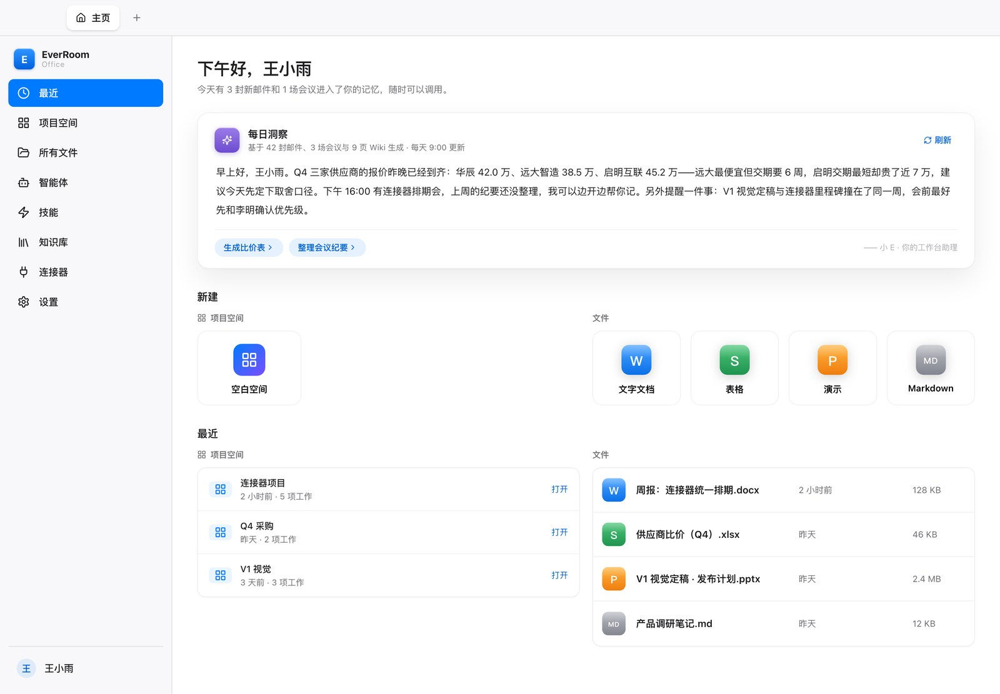
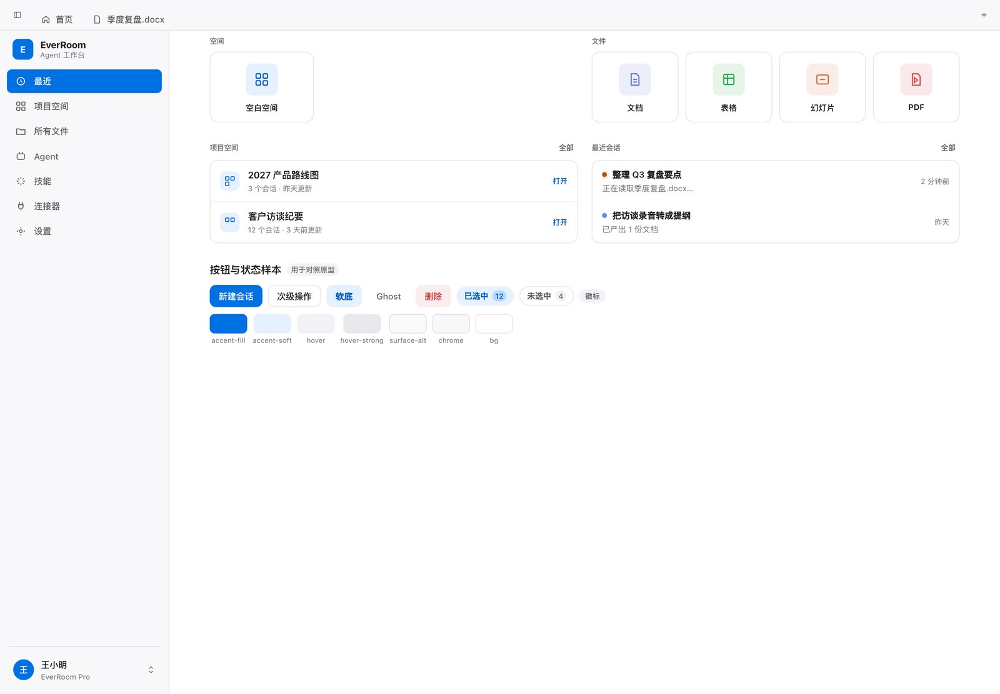
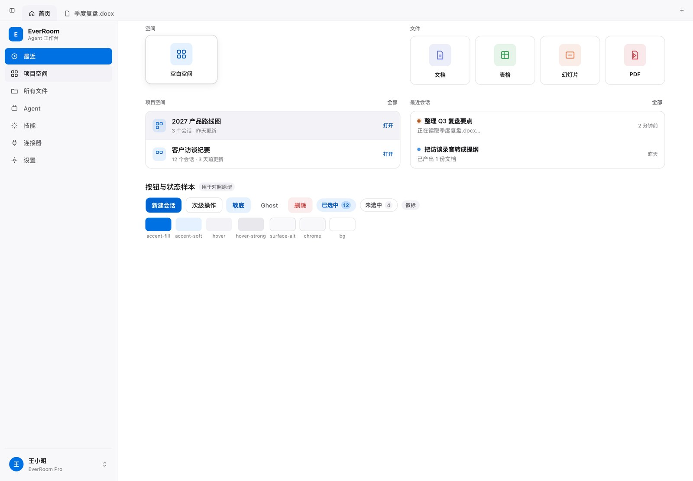

# 素白主题 · 移植 everoffice 原型的 iWork 皮肤（2026-11-03）

> 状态：**已完成**。把 `everoffice` 原型（`/Users/xjwang/EerRoom/everoffice`，Apple iWork 皮肤）
> 的背景层次与按钮手势搬进桌面端，落到「素白（`data-theme='plain'`）」这套外观上，
> 并把 **素白设为默认外观**。范围：外壳（标签栏 / 窗口）、侧栏、首页。

## 1. 原型实测结论

用离屏 Electron 把原型渲染成 1440×1000@2x 截图，并对关键元素取 computed style（`office-proto.css`
在 `.op-root` 里把 `tokens.css` 整套覆写成 Apple 系统色，所以看 token 文件是不够的）：

| 项 | 原型取值 | 说明 |
| --- | --- | --- |
| 画布 `--bg` | `#ffffff` | 纯白，不是近白灰 |
| chrome（标签栏 52 / 侧栏 248） | `rgba(246,246,248,0.78)` + `backdrop-filter: blur(20px) saturate(1.6)` | 毛玻璃；底下就是白画布，所以只呈现「极浅冷灰 vs 纯白」的微妙分层 |
| 编辑台 `--canvas` | `#f2f2f7` | Keynote 灰，只给文档工作区 |
| 线条 | `rgba(0,0,0,.10)` / `.16` / 卡片 `.06` | 全是黑色低透明发丝线 |
| 文字 | `#1d1d1f` / `#6e6e73` / `#aeaeb2` | 元信息 `#aeaeb2` 只有 2.2:1，**未采纳**（我们改用 `#6e6e73`，5.1:1） |
| 主色 | `#007aff` | 实底白字只有 4.02:1，**实底改用 `#0071e3`**（4.7:1）、文字色 `#0064d2`（5.6:1） |
| 侧栏导航 | 高 40 / radius 8；hover `rgba(0,0,0,.05)`；**选中 = 系统蓝实底白字 600**，无阴影 | Finder 惯例，不是我们的「白色浮起卡片」 |
| 主按钮 | `#007aff` 底白字；hover → `#0062d6`；**active `scale(.98)`** | 只有缩放，没有阴影/描边变化 |
| 幽灵按钮 | 白底 + `rgba(0,0,0,.16)` 1px；hover → `#f2f2f7` | |
| 卡片/瓦片 | 白底 + 发丝边（tile radius 14）；**hover = `translateY(-2px)` + `raised-shadow`（`0 1px 2px .05 / 0 4px 14px .07`）** | 抬升克制，阴影很浅 |
| 表格行 | 行间发丝分隔、无外框；**hover = `#f2f2f7`**，并让行尾「…」由隐藏变可见 | |
| 分段控件 | 轨道 `rgba(0,0,0,.05)`；选中 = 白色浮起 + 阴影 | |
| 聚焦环 | `outline: 3px rgba(0,122,255,.35); offset 1px` | 比我们原来的 2px 更粗、更淡 |




## 2. 落地方式

原则：**原型的手感做成 token，组件只认 token**。这样四套外观各自决定「手势幅度」，
组件里不再出现 `translateY(-2px)` / `scale(.98)` 这类硬编码。

### 2.1 token 层

`styles/tokens.css`（默认值 = 暖纸现状，其它主题零变化）：

| token | 默认（暖纸） | 素白（原型） | 用在哪 |
| --- | --- | --- | --- |
| `--ui-press-scale` | `1` | `0.98` | `.ui-btn` / `.ui-iconbtn` 的 `:active` |
| `--ui-card-lift` | `-2px` | `-2px` | 新建瓦片悬停抬升 |
| `--ui-card-lift-sm` | `-1px` | `-1px` | 空间卡片 / 文件网格卡片悬停抬升 |
| `--ui-glass-blur` | `0px` | `20px` | 侧栏 / 标签栏 `backdrop-filter` |
| `--ui-glass-saturate` | `1` | `1.6` | 同上 |
| `--ui-focus-ring-width` / `-color` / `-offset` | `2px` / `--ui-accent-line` / `2px` | `3px` / `rgba(0,122,255,.35)` / `1px` | `.wb-root :focus-visible`、首页按钮 |
| `--ui-nav-active-bg` / `-border` / `-color` / `-icon` / `-shadow` | 白色浮起卡片 | 系统蓝实底白字 | 侧栏导航选中态 |

`styles/themes.css` 的 `plain` 块整体重写：纯白画布、`rgba(246,246,248,.78)` 半透明外框、
黑色低透明线条、`#f2f2f7` 实色悬停、系统蓝强调、原型两段式投影，并给出上面那组手势值。

### 2.2 组件层（外壳 / 侧栏 / 首页）

- `workbench/styles/workbench.css`：侧栏与标签栏挂 `backdrop-filter`；`.wb-nav-item.is-active`
  改吃 `--ui-nav-active-*`；导航 / 标签 / 账号行补 `:active`（深一档底色）；聚焦环改吃 token。
- `workbench/ui/ui.css`：`.ui-btn`、`.ui-btn--primary`、`.ui-iconbtn` 补 `transform` 过渡与
  `:active { transform: scale(var(--ui-press-scale)) }`。
- `workbench/home/home.css`：新建瓦片 / 空间卡片 / 文件卡片悬停抬升幅度改吃 `--ui-card-lift*`；
  空间行、列表行、文件行、筛选 chip 补 `:active`；按钮聚焦环改吃 token。

### 2.3 默认外观 = 素白

- `state/appearanceSettings.ts`：`DEFAULT_APPEARANCE_THEME = 'plain'`，`APPEARANCE_THEMES` 顺序把素白排首位。
- `renderer/index.html` / `debug.html`：首帧内联脚本与 `<html data-theme>` 的默认值改 `plain`。
- `main/appearance-store.ts`：读不到偏好时回落 `plain`；`shared/sources.ts` 建窗底色 `#ffffff`。
- 设置页样本色（`AppearanceSettingsSection.css`）与 zh/en 文案（名称仍是「素白 / Plain」，
  hint 改为「默认。原型 iWork 皮肤：纯白画布 · 毛玻璃侧栏 · 系统蓝实底」）。




## 3. 复现与验收

1. `pnpm --filter @nxcore/desktop typecheck`（已通过）。
2. 视觉对照：底部工具可直接跑离屏截图（`.tmp-preview/` 与 `.tmp-proto/` 都在 gitignore 里，不入库）：

```bash
# 应用侧：把外壳/侧栏/首页的真实 CSS 加载进一个静态样本页并截图
cd .tmp-preview/style-preview
env -u ELECTRON_RUN_AS_NODE ../../apps/desktop/node_modules/.bin/electron \
  --no-sandbox --disable-gpu --in-process-gpu --force-device-scale-factor=2 \
  shoot-one.cjs index.html shot-plain.png        # hover.html 是悬停对照页
```

3. 真机验收：`pnpm --filter @nxcore/desktop dev`，确认设置 → 外观里「素白」为当前项；
   侧栏导航选中为系统蓝实底、瓦片悬停抬升 2px、主按钮按下轻微内收。

## 4. 已知取舍

- **对比度优先于像素级还原**：原型的 `#007aff` 实底 + 白字（4.0:1）、`#aeaeb2` 元信息（2.2:1）
  都达不到 AA，分别改成 `#0071e3` / `#6e6e73`。视觉上仍是同一族的系统蓝与中性灰。
- **毛玻璃在纯白画布上几乎看不出来**（原型也是如此）：它只在窗口叠到桌面上、或内容滚到侧栏后面时
  才生效；层次主要还是靠 1px 发丝线。没有为了「让玻璃可见」而把画布改灰。
- 本轮只覆盖外壳 / 侧栏 / 首页；对话区与内容页（最近 / 所有文件 / 知识库 / 连接器 / 智能体 / 编辑器）
  在素白下只吃到 token 换色，未做逐条手势对齐。后续若要统一，只需把它们的悬停位移换成
  `--ui-card-lift*`、按钮补 `:active`。
